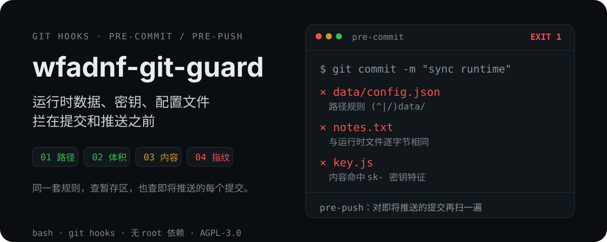

<p align="center">
  
</p>

<p align="center">
  A user-level <code>pre-commit</code> / <code>pre-push</code> leak guard.<br>
  Four layers — <b>path · size · content · fingerprint</b> — checked before git writes anything.
</p>

<p align="center"><a href="README.zh.md">中文</a></p>

## Example output of a blocked commit

```text
$ git commit -m "sync runtime"

============ git-guard blocked commit ============
  x data/config.json
      -> path matched deny rule: (^|/)data/
  x key.js
      -> content matched high-confidence secret pattern
  x notes.txt
      -> content matched secret-assignment pattern
---------------------------------------------------------
Runtime data / secrets / config were probably added by mistake. How to fix:
  git restore --staged <file>        # unstage
  git rm --cached <file>             # remove tracked file from index
  echo '<pattern>' >> .gitignore     # ignore permanently
Rules: ~/.config/git/guard/{deny-paths,deny-content,deny-content-soft}.txt
False positives go into allow-paths.txt; only after confirming it is harmless: GUARD_OVERRIDE=1 git ...
=========================================================
```

`.gitignore` matches paths only, applies per repository, and cannot prevent `git add -f`. git-guard keeps its rules at user level and inspects content: runtime files are fingerprinted in advance, so a byte-identical copy in any repository is blocked, regardless of renaming or extension changes.

## Installation

Requires `bash`, `git`, and GNU `find`/`awk`/`sed`/`grep`. On macOS, run `brew install coreutils findutils gnu-sed` and add `gnubin` to PATH.

```bash
git clone https://github.com/AndyerNotFound/wfadnf-git-guard.git
cd wfadnf-git-guard && ./install.sh
```

Hook templates are installed into `~/.config/git/template`, so repositories cloned afterwards inherit the hooks automatically; existing repositories can be hooked with `git-guard install`. To uninstall, run `./uninstall.sh`.

Add the following two personal settings, then initialize:

```bash
echo 'github.com/yourname/' >> ~/.config/git/guard/owners.txt         # your remotes only
echo "$HOME/app-runtime"   >> ~/.config/git/guard/protected-roots.txt # runtime data directory
git-guard snapshot && wsnap init && wsnap hook on
```

## Usage

| Command | Purpose |
|---|---|
| `git-guard status` | Show configuration, protected directories, and hooked repositories |
| `git-guard audit <dir>` | Audit committed content (file names only) |
| `git-guard snapshot` | Rebuild runtime fingerprints |
| `git-guard check <file>` | Dry run: determine whether a file would be blocked |
| `wsnap verify` | Report workspace changes against the baseline (exit code 3 on alert) |
| `wsnap verify --accept` | Accept the current state as the new baseline |
| `wsnap watch 5` | Resident polling |
| `wsnap hook off` | Remove the prompt hook |

If `termux-api` or `notify-send` is installed, a notification is pushed whenever a commit is blocked, allowing one-tap unstaging or the issuance of a one-time allow token (valid for 10 minutes by default, consumed by the next commit attempt only, and not honored by `pre-push`; the TTL is tunable via `allow-ttl`). `GUARD_NOTIFY=0` suppresses the notification for a single operation, `GUARD_OVERRIDE=1` overrides the check once, and false positives can be whitelisted permanently in `allow-paths.txt`.

## Rules

All files under `~/.config/git/guard/` are plain text, one ERE per line, and take effect immediately after editing.

| File | Purpose |
|---|---|
| `deny-paths.txt` | Path rules: `data/`, `.env`, `*.pem`, logs, archives, etc. |
| `deny-content.txt` | High-confidence patterns: private key headers, `sk-`, `ghp_`, `AKIA`, JWT |
| `deny-content-soft.txt` | Key assignments `key = "…"`; skips `lang`/`test`/`docs` |
| `allow-paths.txt` | Permanent whitelist |
| `protected-roots.txt` | Repositories inside these directories cannot commit or push |
| `owners.txt` | Prefixes of your own remotes |
| `exclude-dirs.txt` | Directories skipped during scanning |
| `private.blobs` | Fingerprint list (generated by `snapshot`) |
| `allowed-repos.txt` | Exceptions inside protected directories |

The size limit is 5 MB; content checks read only the first 1 MB and skip placeholders such as `mock`/`example`; fingerprints match byte-identical files only.

## Limitations

- Not a sandbox: hooks can be removed or modified by the same user, and `--no-verify` bypasses them; the ultimate safeguard is server-side push protection or `pre-receive`.
- Fingerprints do not recognize variants produced by encoding, compression, or encryption.
- Newly cloned repositories (including third-party ones) inherit the template hooks; adjust `init.templateDir` if this is undesired.
- No inotify; newly created files are incorporated at the next `wsnap verify`.
- `audit` lists file names only; rewriting history requires `git filter-repo` or BFG.

## Tests

```bash
bash test/run-tests.sh   # 32 cases, all executed in temporary directories
```

## License

AGPL-3.0
